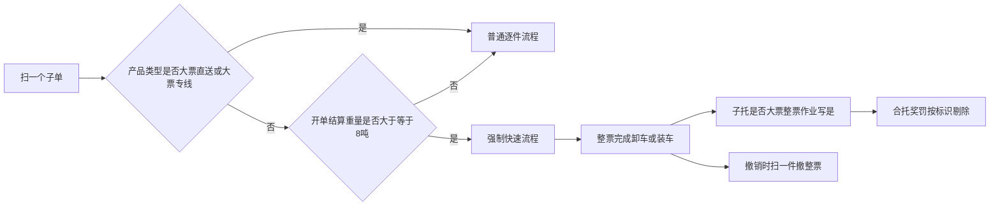

# 【8吨以上大票整票作业】讨论方案

> 整理日期：2026-09-09  
> 需求负责人：胡绵飞  
> 说明：供业务/研发对齐「做什么 / 不做什么」。确认后据此再进原型或 PRD。  
> 本文为一期为主、二期单列记录；未标「待确认」的为一期已拍板结论。

---

## 一、要解决什么问题

1. 单票开单结算重量达到 8 吨及以上时，件数往往很多，卸车、装车若仍逐件扫描，现场耗时长。  
2. 需要一套「扫一个子单 = 整票作业」的快速方式，并强制命中规则的货走这套方式。  
3. 此类货参与合托后，卸车完成算合托奖罚时不应再按普通合托逻辑计奖罚，需可识别、可剔除。  
4. 一期先试点参数落地；二期再做成可维护配置，并支持异常合托手动剔除。

---

## 二、适用范围

| 项 | 结论 |
| --- | --- |
| 适用分拨类型 | 全部：直营分拨中心、非直营分拨中心、服务站、直营集配站、非直营集配站 |
| 一期试点分拨 | 重庆、昆明（系统参数控制；未开参数的分拨不走快速流程） |
| 推广节奏 | 对接计划：9 月完成重庆、昆明改造，10 月推向东北、西北区域（**计划节点，以实际排期为准**） |

---

## 三、一期方案（已拍板）

### 1. 何时走快速流程

同时满足以下条件时，**强制**走快速流程（不可选回普通逐件）；否则走普通逐件：

| 序号 | 条件 |
| --- | --- |
| 1 | **开单结算重量 ≥ 8 吨**（重量只取 **开单结算重量**） |
| 2 | **产品类型** 不是 **大票直送**、不是 **大票专线**（这两类即使重量达标也不走快速流程） |
| 3 | 当前分拨在试点/系统参数开启范围内 |
| 4 | 当前操作为已开启的 **卸车** 或 **装车** |

### 2. 现场怎么扫

| 项 | 结论 |
| --- | --- |
| 作业方式 | **扫任意一个子单 = 整票**完成本次卸车或装车；不做「只扫主单」另一套入口 |
| 卸车、装车 | 本期快速流程改造范围；系统参数可配置开哪些操作类型 |
| 移动 | **不纳入快速流程开关**。原因：卸车会合托，合托后移动本来就只需扫一次，本期不把移动当成快速流程开关项，避免误以为漏配 |
| 撤销 | **只有撤销**（不做单独反扫能力）；撤销同样 **扫一件 = 撤销整票** |
| 结算/单价 | 本期不写、不改；沿用现有薪资配置能力 |

### 3. 合托：打标、奖罚剔除（两件事）

| 事项 | 结论 |
| --- | --- |
| 合托打标 | 走快速处理产生的相关子托，一期写入 **是否大票整票作业**（是/否），便于统计与后续处理 |
| 合托奖罚剔除 | **卸车完成计算合托奖罚时**，按子托「是否大票整票作业」= 是 **剔除**（**认标剔除**；不按重量、产品类型再算一遍） |
| 异常合托手动剔除 | **二期**再做（见下文） |

说明：打标、奖罚认标剔除、二期手动剔除是三件不同的事，不要混成一步。

### 4. 一期怎么配（无维护页）

| 项 | 结论 |
| --- | --- |
| 配置方式 | **不做维护界面**；用系统参数控制 |
| 参数内容 | 试点分拨、操作类型（卸车 / 装车）、重量阈值（默认 **8 吨**） |

### 5. 一期流程示意

---

## 四、二期方案（已记录，本期不开发维护页）

### 1. 配置维护页

| 项 | 结论 / 说明 |
| --- | --- |
| 页面 | 要做配置维护页；正式中文名 **待确认**（暂名：【8吨以上大票整票作业配置】） |
| 适用分拨 | 可配置哪些分拨启用（替代一期写死参数/试点名单） |
| 重量 | 重量阈值可配；取数仍按 **开单结算重量**（除非二期另改） |
| 件数 | 件数阈值可配（二期新增）；与重量如何组合见「待确认」 |
| 操作类型 | 可配置；与一期一致，重点是卸车 / 装车；**默认不配移动**（是否在配置项里露出移动选项见「待确认」） |

### 2. 其他二期事项

| 项 | 说明 |
| --- | --- |
| 合托异常手动剔除 | 支持手动剔除异常合托数据（对接测算工作量可控，具体规则 PRD 阶段再细） |
| 区域推广 | 按试点效果扩展至东北、西北等 |
| 产品类型剔除 | 一期写死为大票直送、大票专线；二期是否改为可配置见「待确认」 |

---

## 五、明确不做 / 本期不写

| 项 | 说明 |
| --- | --- |
| 只扫主单整票的另一套入口 | 一期不做 |
| 薪资单价、结算规则改造 | 本期文档不写；现有薪资配置已可支持 |
| 配置维护页 | 一期不做，放二期 |
| 单独反扫能力 | 不做；纠错用撤销（扫一件撤整票） |
| 把移动做成快速流程开关 | 不做（见上文原因） |

---

## 六、风险与边界（讨论点，非已定细则）

| 类型 | 说明 |
| --- | --- |
| 半票到货 / 少件 | 强制一扫整票后，少件、破损是否仍整票落结果——细则待业务补场景后写进 PRD |
| 改重 / 改产品类型 | 奖罚认标剔除：已打标的不因事后改重、改产品类型自动「取消剔除」或「补计」——若业务要例外，需另定 |
| 合托打标落点 | 子托字段 **是否大票整票作业**（已定） |

---

## 七、待确认

请直接回编号：

1. ~~合托「特殊标识」落点~~ → 已定：子托「是否大票整票作业」
2. 「卸车完成计算合托奖罚」→ 已定：【合托达成率】卸车完成后算合托奖罚（若讨论稿仍列此项可划掉）
3. 二期：重量阈值与件数阈值是 **两个都要满足**，还是 **满足其中一个即可**？  
4. 二期：产品类型剔除（大票直送、大票专线）是否改为可配置？  
5. 二期配置维护页正式中文名定什么？操作类型配置里是否仍不露出「移动」？  
6. 半票到货 / 少件 → 一期 PRD 已定：本期不考虑，仍按整票落结果

---

## 八、下一步

1. 业务确认本文「待确认」及一期结论无歧义。  
2. 确认后按「讨论 → 原型 → PRD」推进：需要时再画 PDA/参数说明或写增量 PRD。
