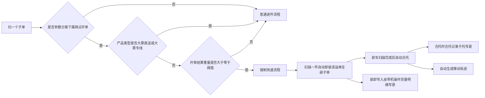
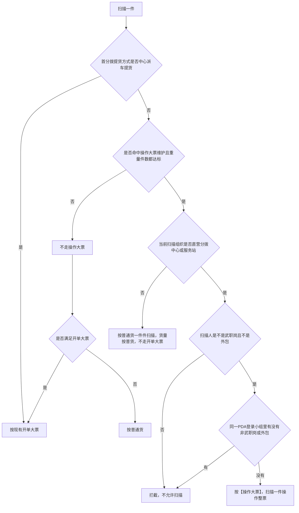

# 【操作大票】PDA操作

| **需求涉及部门** | **需求确认人** |
| ---------- | --------- |
| 需求提出方      | 运营 / 操作相关 |
| 需求负责人      | 胡绵飞       |
| 验收部门负责人    |           |

# 一、概述

| **版本** | **修订人** | **修订时间** | **修订说明**                                                            | **开发负责人** | **测试负责人** |
| ------ | ------- | -------- | ------------------------------------------------------------------- | --------- | --------- |
| V1.0.0 | 胡绵飞 | 2026.9.9 | 新增：快速流程；卸车后自动合托并自动生成移动轨迹；批量异步上传与进度提示；卸车完成/发车拦截未传完；卸车完成弹框与【合托达成率】重刷认标剔除；【移动作业统计】认标不统计；货量落【皮带机操作货量】明细可区分可导（本期不做该页面改造） |  |  |
| V1.1.0 | 胡绵飞 | 2026.9.19 | 升级 PDA 操作：按【操作大票维护】命中；按目的分拨送货方式区分装卸、货量和禁移；中心派车提货走开单大票 |  |  |

# 二、要解决的问题

| **版本** | **问题**                                                                                                                             |
| ------ | ---------------------------------------------------------------------------------------------------------------------------------- |
| V1.0.0 | 1. 单票开单结算重量达到 8 吨及以上时件数很多，卸车、装车仍逐件扫描，现场耗时长、人效低。 2. 这类大票若仍按普通货走完整装卸与移动路径，操作环节多、人力成本高；需要通过整票作业 + 卸车后自动合托并自动生成移动轨迹，**少做装车逐件、少做人工移动**，把成本降下来，同时对外仍有移动轨迹。 3. 卸车完成弹框给操作工看的合托奖罚、预估/实际合托数，以及【合托达成率】重刷子单明细，仍把该类货当普通合托货处理，不合理，需要可识别并剔除。 4. 本需求会自动生成移动轨迹，PC 端【移动作业统计】若仍统计进去，移动考核会虚高，需要认标剔除不统计。 5. 一期此类货要单独算钱，需要能从货量数据里把这部分区分开并导出；数据落【皮带机操作货量】明细表，【皮带机操作货量】页面本期不做改造。 |
| V1.1.0 | 1. 现网临时整票只看重量、还把大票直送/大票专线排除，和业务要的「按目的分拨送货方式分装卸、中心派车提货走开单大票」对不上。 2. 中转没有上一站交件也给货量、没卸就能装，货量会记错。 3. 非直营分拨中心、直营集配站、非直营集配站、智运中心、航空转运枢纽现场不能扫一件操作整票；非武职岗、外包、小组里混了这些人，也不能扫操作大票。 |

# 三、业务分析

## 3.1 用户调研

| **版本** | **调研结果**                                                                                                                                                                                                              |
| ------ | --------------------------------------------------------------------------------------------------------------------------------------------------------------------------------------------------------------------- |
| V1.0.0 | 1. 希望命中规则后强制：可随便扫任一子单（不必扫主子单），将该运单下所有子单自动完成本次卸车或装车；撤销同样扫描一件撤销该运单下所有子单本次结果，且须全部上传完毕才可撤销。 2. 产品类型为大票直送、大票专线的不走这套方式。 3. 一期重庆、昆明试点；**分拨中心支持参数配置**；只有参数分拨下属网点开单的货，且满足既定逻辑，才走快速流程；不做配置维护页。 4. 卸车走快速流程后 **自动合托**，并 **自动生成移动轨迹**；「是否大票整票作业」分两处：【皮带机操作货量】明细在装卸写入时写、合托记录（子托）在合托时写；【移动作业】不能扫该类合托货，需提示（双库等二次移动场景仍要限制）；PC 端【移动作业统计】对该类货 **不统计**。 5. 件数多时后台批量上传、前端不卡住；再扫本票可看上传进度（已上传件数/总件数）；卸车完成、发车时若该类大票未上传完则拦截。 6. **卸车完成弹框**（实时给操作工）：合托奖罚、预估合托数、实际合托数（及弹框内规定子托数等合托相关展示项）按子托标识剔除。 7. **【合托达成率】**本版改 **重刷**（重刷会刷子单明细），重刷时按子托标识剔除。 8. 本版菜单入口只做【实时卸车】【无纸化卸车】【实时装车】【网点装车】。薪资单价本期不改。 9. 一期单独算钱：货量写入【皮带机操作货量】明细表，字段沿用该表明细字段并可导出；**【皮带机操作货量】页面本期不做**。 |
| V1.1.0 | 1. 门槛改到【操作大票维护】配，重量看开单结算重量，重量和件数两个都要满足；不再用产品类型排除。 2. 中心派车提货整票走开单大票。中心自提各环节可扫一件操作整票但禁移；中心直送只有首分拨能扫；网点派送、网点自提的目的分拨改普通逐件。 3. 中转：卸的交接单里要有本票交件才有货量；没卸不能装；卸没有货量，装也不给货量。 4. 只有直营分拨中心、服务站能扫一件操作整票。武职岗才能扫；外包、非武职岗不能扫；同一 PDA 小组里有一人不合格，全组不能扫。 5. 同城件不单独排除，按首分拨规则走。 |

## 3.2 产品方案

| **版本** | **产品方案**                                                                                                                                                                                                                                                                               |
| ------ | -------------------------------------------------------------------------------------------------------------------------------------------------------------------------------------------------------------------------------------------------------------------------------------- |
| V1.0.0 | 1. 系统参数配置启用的 **分拨中心**、重量阈值（默认 8 吨）。 2. **限制**：仅参数分拨中心 **下属网点开单** 的运单（**一点多交不算**），且开单结算重量≥阈值、产品类型不是大票直送/大票专线 → 强制快速流程。 3. 本版入口仅【实时卸车】【无纸化卸车】【实时装车】【网点装车】：可随便扫任一子单（不必扫主子单），将该运单下所有子单自动完成本次卸车或装车；**卸车扫描完成后自动合托，并自动生成移动轨迹**；撤销须全部上传完毕后扫描一件撤销该运单下所有子单本次结果，未传完则拦截并提示。 4. 第一件校验通过后，其余子单 **后台批量上传**，前端可继续扫别的单；再扫本票上传中提示进度（已上传件数/总件数），上传完提示已上传完成；同一运单同时只允许一个整票上传；**卸车完成、发车**时若本交接单仍有该类大票未上传完则拦截。 5. 「是否大票整票作业」分两处写：**【皮带机操作货量】明细**在装卸快速写入时写「是」；**合托记录（子托）**仅在合托时写「是」。【移动作业】**不允许扫描**该类合托货，扫描时拦截并提示；PC 端【移动作业统计】**不统计**该类货。 6. **卸车完成弹框**（卸车完成时实时算，给操作工看）：合托奖罚、预估合托数、实际合托数（及弹框内规定子托数等合托相关展示项），按子托「是否大票整票作业」= 是剔除。 7. **【合托达成率】重刷**：本版改重刷逻辑（重刷会刷子单明细）；重刷时按子托「是否大票整票作业」= 是剔除后再刷相关明细/汇总。 8. 货量写入【皮带机操作货量】明细表，字段沿用该表明细字段，带「是否大票整票作业」可区分可导；**本期不做【皮带机操作货量】页面改造**。 |
| V1.1.0 | PDA 先按【操作大票维护】和扫描组织判断是否走操作大票，再按目的分拨送货方式决定能不能扫、给不给货量、能不能移。上线后只按本版规则跑，不再同时保留临时整票规则。 |

# 四、需求价值

| **版本** | **需求价值**                                                                                           |
| ------ | -------------------------------------------------------------------------------------------------- |
| V1.0.0 | 1. **降成本**：整票作业 + 卸车后自动合托并自动生成移动轨迹，减少装车逐件与人工移动，降低大票重货操作人力成本，对外仍有轨迹数据。 2. **提效率**：扫描一件即可完成该运单下全部子单的本次卸车或装车；批量上传不卡住前端，缩短现场等待。 3. **考核更准**：卸车完成弹框、【合托达成率】重刷、【移动作业统计】按「是否大票整票作业」剔除，合托奖罚/合托数/移动统计不把这类货当普通货算。 4. **可试点、可算清**：分拨参数可控，便于重庆、昆明先跑；货量落【皮带机操作货量】明细可区分可导，支撑一期单独算钱。 |
| V1.1.0 | 1. 现场按送货方式扫，该整票的整票、该逐件的逐件，中心派车提货不混进操作大票。 2. 中转货量跟交接单、跟是否已卸对齐，少记错货量。 3. 非指定组织、非武职岗扫不了操作大票，货量不会记到不该记的人。 |

# 五、详细需求描述

## 5.1 相关链接

| **版本号** | **说明**                                      |
| ------- | ------------------------------------------- |
| V1.0.0  | 评审讨论：[【8吨以上大票整票作业】评审讨论.md](./【8吨以上大票整票作业】评审讨论.md) |
| V1.1.0  | 开单门槛：[操作大票运单管理.md](./操作大票运单管理.md) |

## 5.2 需求描述

### V1.0.0

#### 适用范围

| 项       | 说明                                                         |
| -------- | ------------------------------------------------------------ |
| 适用     | 直营分拨中心、非直营分拨中心、服务站、直营集配站、非直营集配站 |
| 一期试点 | 重庆、昆明（系统参数配置这两个 **分拨中心**；仅其下属网点开单的货才可能走快速流程） |

#### 系统参数（一期无维护页）

| 参数含义 | 说明                                                         |
| -------- | ------------------------------------------------------------ |
| 适用分拨 | 配置哪些 **分拨中心** 启用本能力；一期试点：重庆、昆明。 **限制**：只有这些分拨中心 **下属网点开单** 的运单，才可能走快速流程（再叠加下文触发条件）。 |
| 重量阈值 | 默认 **8**（单位：吨）；与开单结算重量比较用                 |

**【移动作业】**（PDA）：不纳入「扫描一件自动卸/装该运单全部子单」开关。合托记录（子托）「是否大票整票作业」在 **合托时**写入。**【移动作业】不允许扫描**该类合托货，扫描时拦截并提示（见下文）。

#### 菜单操作入口（本版）

本版「扫描一件 → 该运单下所有子单自动本次卸车或装车」快速流程，**只改下列菜单**；其他卸车/装车入口本版不做。

| 菜单全称 | 归属 |
| --- | --- |
| 【实时卸车】 | 卸车 |
| 【无纸化卸车】 | 卸车 |
| 【实时装车】 | 装车 |
| 【网点装车】 | 装车 |

另：【移动作业】**不作为**上表快速流程入口；且 **禁止扫描**「是否大票整票作业」= 是的合托货（拦截并提示）。

#### 快速流程触发判定

在上述卸车/装车菜单扫描时，按下列条件判定（**全部满足**才走快速流程；任一不满足则走普通逐件）：

1. 运单为「适用分拨」参数中已配置的 **分拨中心下属网点开单** 的货（开单网点归属该分拨中心）。
2. 运单 **开单结算重量 ≥ 重量阈值**（默认 8 吨）；重量只取 **开单结算重量**。
3. 运单 **产品类型** 不是 **大票直送**或者**大票专线**（这两类即使重量达标也不走快速流程）。

**最终效果**：只有参数配置了的分拨中心下面网点开单的货，并且满足上述全部逻辑，才走本快速流程；否则普通逐件扫描。

命中后：**强制**走快速流程，不可选回普通逐件。

#### 装卸扫描

| 项 | 说明 |
| --- | --- |
| 适用菜单 | 仅【实时卸车】【无纸化卸车】【实时装车】【网点装车】 |
| 作业结果 | **可随便扫描该运单下任一子单**，**不必**扫描主子单（如 001）。扫一件后，即将该运单下 **所有子单** 自动完成本次卸车或装车 |
| 撤销 | 1.快速流程下，**扫描一件**（同样可不限定主子单），即将该运单下 **所有子单** 本次已完成的卸车或装车结果一并撤销。 2.  **限制**：                1.**撤销：**该类货须 **全部上传完毕** 才允许撤销；未上传完时 **不允许撤销**。                             1.提示文案：上传未完成（已上传×/共×件），暂不可撤销。               2.**装车扫描：**该类货须 **卸车扫描全部上传完毕** 才允许装车扫描；未上传完是 不允许撤销。                           1.  提示文案：卸车上传未完成（已上传×/共×件），暂不可装车。 |
| 卸车自动合托 | 【实时卸车】【无纸化卸车】走快速流程时：扫描完成后，该类货 **自动合托**（无需再单独做合托操作） |
| 自动生成移动轨迹 | 卸车整票处理合托时，系统 **自动生成移动轨迹**（非员工在【移动作业】扫描产生）。对内仍限制人工再移；对外保证有轨迹数据 |
| 装卸货量标识 | 走快速流程时，在 **【皮带机操作货量】明细** 写入「是否大票整票作业」= 是（**装卸写入时写入**，不是合托时写） |
| 合托标识 | **自动合托时**，在 **合托记录（子托）** 写入「是否大票整票作业」= 是（**仅合托时写入**，不在装卸扫描动作写入） |
| 半票到货 / 少件 | **本期不考虑**特殊处理；仍按上述将运单下所有子单自动完成本次作业 |

#### 批量上传与进度提示

件数多时，扫一件后该运单其余子单由 **后台批量上传**；产品交互如下（实现细节由研发按此落地，本版不写接口协议）：

| 项 | 说明 |
| --- | --- |
| 前端不卡住 | 第一件校验通过后，前端可继续扫描 **其他运单**，不等待本票全部子单上传完 |
| 再扫本票（上传中） | 1.提示上传中，并展示已上传件数 / 总件数（不用普通「子单重复扫描」冒充进度）。 2.提示文案示例：上传中，已上传 320/1000 件 |
| 再扫本票（已上传完） | 1.提示已上传完成（不用普通「子单重复扫描」含糊带过）。 2.提示文案示例：该票已上传完成 |
| 锁 | 同一运单同时只允许一个整票上传在跑；其他终端再扫本票只看进度/完成提示，不再起第二个上传 |

#### 卸车完成 / 发车拦截

| 项 | 说明 |
| --- | --- |
| 卸车完成 | 1.点卸车完成时：若本交接单仍有本需求快速流程的大票 **未上传完** → **不允许卸车完成**。 2.提示文案示例：尚有大票未上传完（剩余×票），暂不可卸车完成 |
| 发车 | 1.点发车时：同样，该类大票未上传完 → **不允许发车**。 2.提示文案示例：尚有大票未上传完（剩余×票），暂不可发车 |
| 范围 | 装卸侧都要有上述拦截（与本版菜单入口对应的卸车完成、发车动作） |

#### 【移动作业】限制

| 项 | 说明 |
| --- | --- |
| 限制 | 【移动作业】**不允许**扫描「是否大票整票作业」= **是** 的合托货物（本需求产生的大票整票合托货） |
| 提示 | 1.扫描到该类货时 **拦截并提示**，不写入移动作业结果。 2.提示文案：大票整票合托货，不支持【移动作业】扫描 |
| 判定 | 认子托「是否大票整票作业」= 是；不按重量、产品类型再判一遍 |
| 为何仍限制 | 已自动生成移动轨迹后，双库等场景仍可能二次移动；对内仍禁止在【移动作业】再扫该类合托货 |

#### 【移动作业统计】剔除

本需求会 **自动生成移动轨迹**，PC 端【移动作业统计】若不剔除，可能把这类货统计进移动货量。本版【移动作业统计】**不统计**该类货。

| 项 | 说明 |
| --- | --- |
| 改什么 | PC 端【移动作业统计】统计口径 |
| 怎么改 | 子托「是否大票整票作业」= **是** 的货，从【移动作业统计】**剔除，不统计**（查询列表、汇总、导出凡纳入统计的，一并剔） |
| 判定 | 认子托「是否大票整票作业」= 是；不按重量、产品类型再判一遍 |
| 其余 | 【移动作业统计】未点名改动的查询、展示等沿用现网，本版不改 |

#### 货量区分与导出

一期此类货要单独算钱，系统侧保证货量数据 **能区分、可导出**；不做自动推送算薪；**本期不做【皮带机操作货量】前端页面改造**（页面后续再做）。

| 项    | 说明                                                           |
| ---- | ------------------------------------------------------------ |
| 落数   | 本需求产生的装卸货量数据，写入 **【皮带机操作货量】明细表**（与皮带机操作货量同一套明细） |
| 字段   | 字段沿用 **【皮带机操作货量】明细表** 现有字段；另带「是否大票整票作业」区分本类货；**不为本期单独算钱新增其他货量业务字段** |
| 导出   | 可从该明细数据导出给业务线下算钱 |
| 页面   | **本期不做**【皮带机操作货量】页面改造；也不新建专用货量报表页面 |

#### 卸车完成弹框

子托「是否大票整票作业」= **是** 的，下列项均 **认标剔除** 后再算/展示（不按重量、产品类型再判）：

| 项 | 说明 |
| --- | --- |
| 合托奖罚 | 弹框内卸车完成实时计算的合托奖罚，剔除该类货 |
| 预估合托数 | 弹框展示的预估合托数，剔除该类货后再展示 |
| 实际合托数 | 弹框展示的实际合托数，剔除该类货后再展示 |
| 规定子托数等 | 弹框内若还有规定子托数等合托相关展示项，一并认标剔除后再展示 |

#### 【合托达成率】重刷

本版【合托达成率】要改的是 **重刷**（因重刷会刷 **子单明细** 数据），不要与「卸车完成弹框」混写。

| 项 | 说明 |
| --- | --- |
| 改什么 | 【合托达成率】**重刷**逻辑 |
| 为什么改 | 重刷会刷子单明细；须带上「是否大票整票作业」口径，避免重刷后明细/汇总仍把该类货按普通合托货处理 |
| 怎么改 | 重刷时，子托「是否大票整票作业」= **是** 的，按认标剔除规则处理后再刷子单明细及相关汇总（与卸车完成弹框同一套认标口径；具体剔哪些重刷字段与现网重刷范围一致，仅增加本标识条件） |
| 其余 | 【合托达成率】查询展示等未点名改动的，沿用现网，本版不改 |

#### 明确不做（本版）

| 项               | 说明                             |
| --------------- | ------------------------------ |
| 配置维护页           | 二期再做                           |
| 件数阈值            | 二期再做                           |
| 合托异常手动剔除        | 二期再做                           |
| 薪资单价 / 结算规则改造   | 本版不改；沿用现有薪资配置；单独算钱靠【皮带机操作货量】明细区分后导出 |
| 现有货量报表页面改造 / 专用货量报表 / 自动推送算薪 | 本期不做【皮带机操作货量】页面改造；不新建专用报表页面；不做自动推送 |
| 移动做成整票快速扫描入口 | 不做 |
| 【移动作业】扫本需求合托货 | **不支持**；扫描拦截并提示 |
| 其他卸车/装车菜单 | 本版不做快速流程（仅【实时卸车】【无纸化卸车】【实时装车】【网点装车】） |
| 一点多交 | **不算**：一点多交运单不走本快速流程 |

#### 验收要点

| 序号  | 验收要点                                                                    |
| --- | ----------------------------------------------------------------------- |
| 1 | 参数已配置分拨中心下属网点开单的货：在【实时卸车】【无纸化卸车】【实时装车】【网点装车】命中全部规则时强制快速流程——可随便扫任一子单（不必扫主子单），将该运单下所有子单自动完成本次卸车或装车 |
| 2 | 【实时卸车】【无纸化卸车】走快速流程：扫描完成后该类货自动合托，并自动生成移动轨迹 |
| 3 | 非参数分拨中心下属网点开单的货：即使重量、产品类型等其他条件满足，也不走快速流程 |
| 4 | 一点多交运单：不走快速流程，仍普通逐件 |
| 5 | 产品类型为大票直送或大票专线：即使开单结算重量≥8吨，仍走普通逐件 |
| 6 | 开单结算重量不足阈值：走普通逐件 |
| 7 | 快速流程撤销：该类货全部上传完毕后，扫描一件可撤销该运单下所有子单本次卸车或装车结果；未全部上传完成时不允许撤销，并提示（含已上传件数/总件数） |
| 8 | 走快速流程：【皮带机操作货量】明细「是否大票整票作业」= 是（装卸写入时写）；自动合托后合托记录（子托）「是否大票整票作业」= 是（合托时写） |
| 9 | 【移动作业】扫描「是否大票整票作业」= 是的合托货：拦截并提示，不写入作业结果 |
| 10 | 第一件校验通过后，前端可继续扫其他运单；再扫本票上传中提示已上传件数/总件数；上传完提示已上传完成 |
| 11 | 同一运单同时只允许一个整票上传在跑 |
| 12 | 卸车完成：本交接单仍有该类大票未上传完时，不允许卸车完成并提示 |
| 13 | 发车：该类大票未上传完时，不允许发车并提示 |
| 14 | 卸车完成弹框（实时给操作工）：合托奖罚、预估合托数、实际合托数及弹框内规定子托数等合托相关项，均剔除「是否大票整票作业」= 是的子托 |
| 15 | 【合托达成率】重刷：按「是否大票整票作业」= 是剔除后再刷子单明细及相关汇总 |
| 16 | PC 端【移动作业统计】：子托「是否大票整票作业」= 是的货不统计（列表、汇总、导出凡纳入统计的一并剔） |
| 17 | 货量写入【皮带机操作货量】明细表，字段沿用该表明细并可导出；本期无【皮带机操作货量】页面改造 |
| 18 | 本版未改的其他卸车/装车菜单无快速流程改造 |
| 19 | 本功能未上线，无历史子托标识数据需迁移 |

### V1.1.0

扫描入口仍是【实时卸车】【无纸化卸车】【实时装车】【网点装车】。上线后只按本版规则跑，不再同时保留临时整票规则。

本版走操作大票的入口只有上述四个。除这四个入口外，其他入口（含【皮带机卸车】【双库倒货】等）只限制直营分拨中心、服务站：

| 当前扫描分拨 | 规则 |
| --- | --- |
| 直营分拨中心、服务站 | 不支持扫描【操作大票】的货。拦截，不写入本次结果。提示：不支持扫描【操作大票】，请使用实时操作。 |
| 非直营分拨中心、直营集配站、非直营集配站、智运中心、航空转运枢纽 | 不拦。按普通货一件一件扫描，跟普通货物一样，本版不改。 |

#### 何时走操作大票

扫描时按下面顺序判断。直营分拨中心或服务站命中后，强制走操作大票，不能改回普通逐件。

| 步骤 | 规则 |
| --- | --- |
| 1. 中心派车提货 | 首分拨提货方式 = 中心派车提货：整票不进操作大票，按现有开单大票走。 |
| 2. 取配置 | 按开单网点匹配【操作大票维护】，有网点行先用网点行（剔除名单不影响网点行）： 1. 没有网点行，有所属分拨的分拨行，且该网点不在剔除网点里：用分拨行。 2. 没有网点行，且该网点在所属分拨的剔除网点里：不走操作大票，也不再看全国行。 3. 没有网点行、也没有能用的分拨行：全国行的分拨类型按【数据权限组件】的分类去对。对上才用全国行。具体怎么区分，评审时再定。 4.注意：匹配网点行时，如果开单网点是二级网点，但是二级网点未维护，但是一级网点有维护，则取一级网点。4. 都没有：不走操作大票。 |
| 3. 重量和件数 | 用上一步那一行判断：开单结算重量 ≥ 重量阈值，并且开单件数 ≥ 件数下限、≤ 件数上限。两个都要满足。任一不满足：不走操作大票。 |
| 4. 扫描组织 | 当前扫描组织是直营分拨中心或服务站，才继续走操作大票。已经命中操作大票，但当前是非直营分拨中心、直营集配站、非直营集配站、智运中心、航空转运枢纽：按普通货一件件扫描，货量也按普货，不走开单大票。货发到路由下一个直营分拨中心后，由该分拨再判断。例：天水集配站（非直营）发西安分拨中心，西安分拨中心可以扫一件操作整票。 |
| 5. 不看产品类型 | 大票直送、大票专线不再排除。别的条件满足就可以进。 |
| 6. 同城件 | 交件网点、派件网点同属一个分拨：这时首分拨和目的分拨是同一个分拨，只按该送货方式的首分拨模式操作，不按目的分拨货中转分拨算。例如中心直送不因为同时也是目的分拨就禁止操作；网点派送、网点自提也不改成普通逐件扫描。 |
| 7. 不走操作大票时 | 没命中操作大票的：满足开单大票按开单大票，否则按普通货。已经命中操作大票、但扫描组织不是直营分拨中心或服务站的：按普通货一件件扫描，货量也按普货。 |

首分拨提货方式分两种：中心派车提货、网点交件。中心派车提货按上面不进操作大票。网点交件才继续按目的分拨送货方式操作。网点交件、中心派车提货，以及目的分拨送货方式（中心自提 / 中心直送 / 网点派送 / 网点自提），都按现网大票专线/大票直送的取值逻辑。

#### 当前分拨判断逻辑

| 分拨 | 逻辑 |
| --- | --- |
| 首分拨 | 寄件网点对应的所属分拨。注意：不是第一个扫描的分拨，也不是路由上的首分拨。一点多交不算首分拨。 |
| 目的分拨 | 路由的目的分拨。 |
| 中转分拨 | 不是首分拨、也不是目的分拨。开单网点、目的网点同属一个分拨时，没有中转。 |
| 同城 | 开单网点、目的网点同属一个分拨时，这个分拨既是首分拨也是目的分拨。只按首分拨认，不按目的分拨认。 |

#### 按目的分拨送货方式

下表「可扫一件操作整票」只在当前扫描组织是直营分拨中心或服务站时生效。

| 目的分拨送货方式 | 首分拨 | 中转分拨 | 目的分拨 | 移动 |
| --- | --- | --- | --- | --- |
| 中心自提 | 扫一件操作整票。卸车、装车都给货量。 | 可扫一件操作整票。货量按下方中转规则。 | 扫一件操作整票。卸车、装车各自给货量，互不挂钩。只有卸车做提示。 | 全禁 |
| 中心直送 | 扫一件操作整票。卸车、装车都给货量。 | 禁止操作 | 禁止操作 | 全禁 |
| 网点派送 / 网点自提 | 同**中心自提**的首分拨（扫一件操作整票。卸车、装车都给货量。） | 同**中心自提**的中转分拨（可扫一件操作整票。货量按下方中转规则。） | 普通逐件。货量不进操作大票。 | 首分拨、中转禁止；目的分拨按现网可以移动 |

**扫一件操作整票：** 可扫该运单下任一子单，不必扫主子单。扫一件后，该运单下所有子单完成本次卸车或装车。

**中转分拨货量（中心自提、网点派送、网点自提的中转；中心直送的中转不走这里）：**

不给货量时，扫描结果和货量都要记。货量类型写成【操作大票不计入货量】，不参与操作货量分配。给货量的写成【操作大票计入货量】。

**卸车**

| 情况 | 规则 |
| --- | --- |
| 卸车交接单里有本票上一站交件 | 可以卸。货量类型 = 【操作大票计入货量】 |
| 卸车交接单里没有本票交件 | 先弹框，不直接卸。文案：上一站未交接，卸出无货量，请确认是否卸出？按钮：「取消」「继续卸出」。 1. 「取消」：不写本次卸车结果，不给货量，关闭弹框，回到扫描页，可继续扫别的单。 2. 「继续卸出」：完成本次整票卸车。货量类型 = 【操作大票不计入货量】。 |

**装车**

| 情况 | 规则 |
| --- | --- |
| 还没卸（当前库存分拨不为当前分拨） | 不允许装车扫描并提示。提示文案：大票货，未入库不得装车。 |
| 已卸（当前库存分拨为本分拨），且卸车货量类型 = 【操作大票计入货量】 | 可以装。货量类型 = 【操作大票计入货量】 |
| 已卸（当前库存分拨为本分拨），且卸车货量类型 = 【操作大票不计入货量】 | 可以装。货量类型 = 【操作大票不计入货量】。不提示，直接装。卸车未计入货量，本次装车也不计入。 |

已经写成【操作大票不计入货量】的卸车、装车，后面不能改成【操作大票计入货量】。本版不做改回。

**目的分拨操作并且是中心自提，只有卸车扫描弹框强提示。** 装车不要这套提示。

| 项 | 规则 |
| --- | --- |
| 提示逻辑 | 目的分拨、送货方式=中心自提、走操作大票卸车扫描命中后，先出弹框，不直接完成卸车。 |
| 文案 | 大票自提货，找主管核实是否卸出，建议客户提货时再卸；违规卸车将扣本票货量并处罚责任人。 |
| 语音 | 弹出时语音播报上述文案。 |
| 按钮 | 「继续卸车」「取消」。 |
| 「继续卸车」 | 弹出后约 10 秒内不可点（灰掉）；10 秒后可点。点后完成本次整票卸车，货量类型 = 【操作大票计入货量】。**若本票已有运单列表「到件并通知」写下的卸车轨迹：**写库存等其余卸出数据，写目的分拨卸出时间/扫描人，**不再写卸车轨迹**。**若电脑没点过：**按完整卸出写轨迹、库存、货量。是否已发短信=否时发短信并改为是；已经是是的不再发。和运单列表是同一条短信。 |
| 「取消」 | 随时可点。不写本次卸车结果，不给货量，不发短信，关闭弹框，回到扫描页，可继续扫别的单。 |

**禁止操作**（中心直送的中转、目的分拨）：卸车、装车都不允许扫，不写入本次结果，并提示。提示文案：直送客户货物，严禁卸出。

**移动全禁或首分拨/中转禁止：** 在【移动作业】扫描时拦截，不写入移动结果，并提示。提示文案：【操作大票】货物，不支持【移动作业】扫描。网点派送、网点自提的目的分拨，【移动作业】按现网，本版不改。

#### 谁可以扫

只拦本应走操作大票、并且当前扫描组织是直营分拨中心或服务站的扫描。不是直营分拨中心、服务站扫描的，按普通货一件件扫描，不限制必须是武职岗，扫描权限跟现网一样，本版不改。目的分拨已按普通逐件的，扫描权限也沿用现网，本版不改。

下表只用于直营分拨中心、服务站走操作大票的扫描。

| 谁 | 规则 |
| --- | --- |
| 可以扫 | 岗位 = 武职岗，且不是外包。含装卸工、移动、L码货员等。 |
| 不能扫 | 非武职岗（文员、操作主管、后勤服务主管等）、外包人员。拦截，不允许扫描。提示文案：大票货，只允许自有装卸人员操作。 |
| 同一 PDA 小组 | 小组里只要有一人是非武职岗或外包，全组都不能扫。拦截，不允许扫描。提示文案：大票货，货量只分自有装卸人员，请核查登PDA人员明细。 |

#### 货量

| 项 | 规则 |
| --- | --- |
| 谁的扫描给货量 | 只要本次扫描允许完成，就给货量。货量类型按上面规则写【操作大票计入货量】或【操作大票不计入货量】。 |
| 推送 | 操作大票货量要推送。推到哪里、推哪些货量，确认后再写。 |
| 合托类型 | 卸车自动合托时，合托记录的合托类型 = 操作大票。 |

#### 改单之后怎么扫

按当前运单判断。现在是操作大票，就按操作大票模式扫；不是操作大票，就不按操作大票模式扫。

批量上传、上传进度、撤销须全部传完、卸车完成/发车拦截未传完、卸车后自动合托并自动生成移动轨迹：沿用现网，本版不改。

#### 本期不在本版

| 项 | 说明 |
| --- | --- |
| 提成单价算薪 | 不做 |
| 【操作大票运单管理】【操作大票货量查询】 | 后面单独写。操作货量不在【操作大票运单管理】里单独做，做到现有【操作货量查询】 |
| 电脑端卸出、入库 | 运单列表「到件并通知」：只写卸车轨迹、不计货量、不写库存，见【操作大票运单管理】。目的分拨中心自提 PDA 点「继续卸车」：有电脑轨迹则补库存和货量、不重复写轨迹；无电脑轨迹则完整卸出 |
| 【分拨实时库存】 | 不单独改取数 |
| 分批配载 | 本期不考虑 |

#### 验收要点

| 序号 | 验收要点 |
| --- | --- |
| 1 | 首分拨提货方式 = 中心派车提货：不走操作大票，按开单大票 |
| 2 | 开单结算重量、开单件数按【操作大票维护】命中行判断，两个都要满足；命中不到、或在剔除网点里且没有网点行：不走操作大票 |
| 3 | 大票直送、大票专线不再因为产品类型被排除 |
| 4 | 已命中操作大票，但在非直营分拨中心、直营集配站、非直营集配站、智运中心、航空转运枢纽扫描：按普通货一件件扫描，货量也按普货，不走开单大票；直营分拨中心、服务站才走扫一件操作整票 |
| 5 | 中心自提：各环节可扫一件操作整票；中转卸车交接单没有本票交件时弹框「上一站未交接，卸出无货量，请确认是否卸出？」，取消不卸，继续卸出则货量类型=【操作大票不计入货量】；目的分拨卸车弹框强提示（继续卸车约 10 秒后可点、取消随时可点）；点继续卸车后货量计入，是否已发短信=否才发短信；若电脑已写过卸车轨迹则不重复写轨迹、写库存和货量；移动全禁 |
| 6 | 中心直送：只有首分拨可扫；中转、目的分拨禁止操作并提示「直送客户货物，未分拨严禁卸出」，不是改成逐件 |
| 7 | 网点派送、网点自提：目的分拨普通逐件且货量不进操作大票；目的分拨移动按现网 |
| 8 | 不是直营分拨中心、服务站扫描：一件件扫，不限制必须武职岗，跟现网一样。直营分拨中心、服务站走操作大票时：非武职岗/外包提示「大票货，只允许自有装卸人员操作」；小组中有不合格人员提示「大票货，货量只分自有装卸人员，请核查登PDA人员明细」；均拦截不允许扫描 |
| 9 | 交件网点、派件网点同属一个分拨：不排除。首分拨和目的分拨是同一个分拨，只按首分拨模式操作，不按目的分拨规则。一点多交不以第一个扫描分拨当首分拨 |
| 10 | 改单后按当前运单判断：现在是操作大票就按操作大票模式扫，不是操作大票就不按操作大票模式扫 |
| 11 | 没命中操作大票、且不是中心派车提货：满足开单大票按开单大票，否则按普通货 |
| 12 | 直营分拨中心、服务站在【实时卸车】【无纸化卸车】【实时装车】【网点装车】以外的入口扫描【操作大票】的货：拦截并提示「不支持扫描【操作大票】，请使用实时操作」。非直营分拨中心、直营集配站、非直营集配站、智运中心、航空转运枢纽在这些入口不拦，按普通货一件一件扫描。中转还没卸就装提示「大票货，未入库不得装车」；已写成【操作大票不计入货量】的不能改成计入 |
